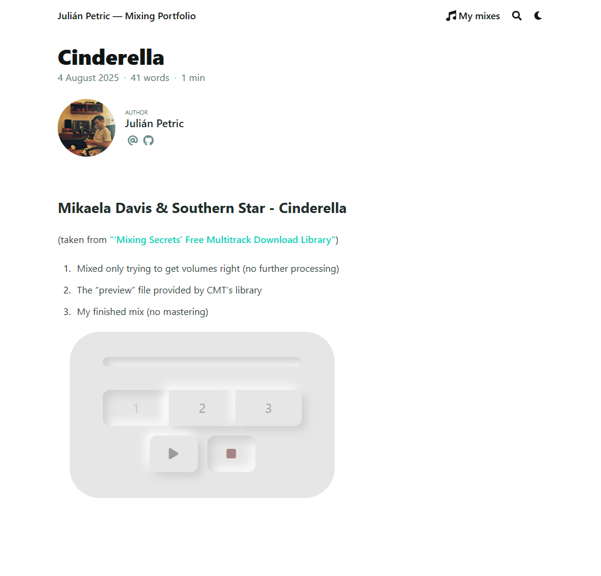

# Mixing portfolio

Personal audio-mixing portfolio of Julián Petric, built with [Hugo](https://gohugo.io/) and the [Blowfish](https://blowfish.page/) theme.

**Live site: <https://julipetric.github.io/music-portfolio/>**

Each page under `/mixes/` presents one song and lets the listener switch, in real time and at the same playback position, between three versions of it:

1. a raw balance of the multitrack with levels only and no further processing,
2. the reference "preview" mix distributed with the multitrack,
3. the finished mix (no mastering).



## The A/B/C player

The player is a custom Hugo shortcode (`layouts/shortcodes/ab-player.html`) driven by a small script (`assets/js/ab-player.js`) and styled by `assets/css/ab-player.css`.

- Two or three versions of the same song are loaded as separate audio elements, and all of them share one playhead. Only the selected version is audible; switching keeps the position, so the listener hears the same passage in another version.
- The numbered buttons select the version. With three versions the buttons are, in order: `data-audio-a`, `data-audio-c`, `data-audio-b`. With two versions they are `data-audio-a` and `data-audio-b`.
- Play/pause, stop and a clickable progress bar act on the whole group.
- The script and stylesheet are processed by Hugo Pipes (bundled, minified and fingerprinted) and are emitted once per page, so several players can share a page.

### Using the shortcode

Put the audio files in the same folder as the page and reference them with relative paths:

```markdown

```

| Parameter      | Required | Meaning                                                          |
| -------------- | -------- | ---------------------------------------------------------------- |
| `data-audio-a` | yes      | Version on the first button.                                     |
| `data-audio-b` | yes      | Version on the last button.                                      |
| `data-audio-c` | no       | Version on the middle button; when present, `b` becomes button 3. |

The build fails with an explicit error if `data-audio-a` or `data-audio-b` is missing.

## Stack

- [Hugo](https://gohugo.io/) extended 0.145.0 (JavaScript bundling uses `js.Build`, which needs the extended edition).
- [Blowfish](https://github.com/nunocoracao/blowfish) theme, included as a git submodule in `themes/blowfish`.
- Site configuration in `config/_default/`.
- GitHub Actions (`.github/workflows/hugo.yaml`) builds the site on every push to `main` and deploys it to GitHub Pages.

## Local development

```sh
git clone --recurse-submodules https://github.com/julipetric/music-portfolio.git
cd music-portfolio
hugo server
```

The site is served at <http://localhost:1313/music-portfolio/>. If the repository was cloned without `--recurse-submodules`, run `git submodule update --init` to fetch the theme.

`hugo --minify` produces the production build in `public/`.

## Adding a new mix

Each mix is a [page bundle](https://gohugo.io/content-management/page-bundles/): a folder under `content/mixes/` containing an `index.md` and the audio files it plays.

```
content/mixes/MySong/
├── index.md
├── MySong_VolumesOnly.mp3
├── MySong_Preview.mp3
└── MySong_FinalMix.mp3
```

`index.md`:

```markdown
+++
date = '2025-01-31T12:00:00-03:00'
title = 'My Song'
+++

## Artist - My Song

1. Mixed only trying to get volumes right (no further processing)
2. The reference preview
3. My finished mix (no mastering)


```

The three versions should be loudness-matched and start at the same point in the song, so that switching between them is a fair comparison. The new page appears in the `/mixes/` list automatically.

## Credits

- The multitracks come from the Cambridge-MT ["Mixing Secrets" Free Multitrack Download Library](https://cambridge-mt.com/ms/mtk/). The recordings and the reference previews belong to their respective artists and to Cambridge-MT.
- Theme: [Blowfish](https://github.com/nunocoracao/blowfish) by Nuno Coração, MIT licensed.
- The player script is based on [AB-Audio-Player](https://github.com/mattbartley/AB-Audio-Player) by Matt Bartley, MIT licensed.
- Icons: [Font Awesome](https://fontawesome.com/) Free, loaded from cdnjs.

## License

The source code of this repository (templates, scripts, styles and configuration) is available under the [MIT License](LICENSE).

The audio files under `content/mixes/` are **not** covered by that license and are not licensed for reuse: the source recordings are the property of their artists and are used under the terms of the Cambridge-MT library, and the mixes are published for portfolio purposes only.
